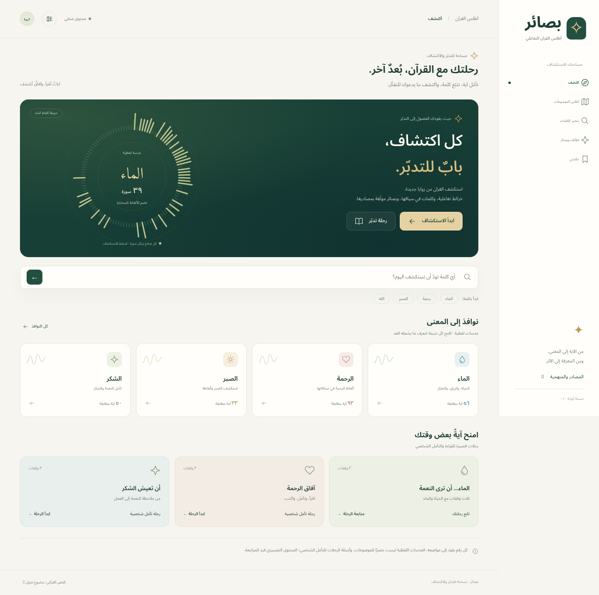
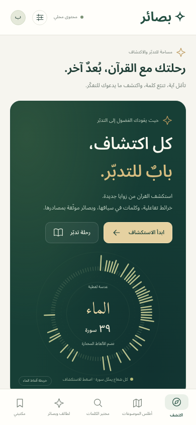

# بصائر — نسخة تطوير ٠٫١

تطبيق عربي لاستكشاف القرآن بصريًا. يشترك مشروع الجوال ومعاينة المتصفح في الواجهة ومحرك البحث نفسه لتوحيد الحسابات.



<details><summary>معاينة شاشة الجوال</summary>



</details>

## ما يعمل في المعاينة

- خمس وجهات: اكتشف، الأطلس، مختبر الكلمات، لطائف وبصائر، مكتبتي.
- النص العثماني الكامل من تنزيل: ٦٢٣٦ آية، و١١٤ سورة.
- البحث بكلمة كاملة بعد التطبيع أو بالمطابقة الحرفية، ونطاق السور والمقارنة مع الاحتفاظ بالنطاق عند فتح المواضع.
- عشر عدسات لفظية بقوائم ألفاظ ظاهرة، وخريطة تفاعلية لكل سورة مع قائمة نصية للنتائج.
- ثلاث رحلات قراءة وتأمل شخصي، وحفظ التقدم والتأملات والمفضلة.
- بطاقة PNG مربعة أو عمودية، وبطاقة آية تتمدد لحفظ النص كاملًا، مع مصدر وطريقة عد وبديل نصي للمعاينة.
- تصدير واستعادة المكتبة، وحماية البيانات السابقة عند فشل الحفظ، ونسخة إنقاذ حرفية من البيانات غير المقروءة.
- العمل دون شبكة بعد تحميل حزمة المعاينة وتفعيل عامل الخدمة، ومظهر داكن وتكبير النص ودعم RTL ولوحة المفاتيح.

## ما لم يُعتمد بعد

المواد التفسيرية والتصنيف الموضوعي واللطائف العلمية ليست محتوى معتمدًا للنشر في هذه النسخة. العدسات مطابقة لفظية محددة، وأسئلة الرحلات تأمل شخصي وليست تفسيرًا. تحليل الجذور غير مفعّل لعدم إضافة قاعدة صرفية موثقة. لا يوجد ادعاء أسبقية أو إعجاز مبني على توافق أعداد.

مشروع Flutter وأجزاء SQLite والمشاركة واختيار الملفات موجودة كمصدر. لم تُشغّل اختبارات Dart ولا Flutter analyze، ولم يُبن APK أو IPA، لأن SDK غير موجود وتنزيله الرسمي محجوب في البيئة الحالية. لا تعتبر هذه نسخة متجر جاهزة.

## تشغيل المعاينة

تحتاج Node.js ٢٠ أو أحدث. لا توجد مكتبات تشغيل خارجية، ولا تحتاج شبكة لتشغيل المحتوى المحلي:

```bash
git clone https://github.com/alhasanelabed-sys/basair.git
cd basair
npm run build
npm run serve
```

افتح `http://127.0.0.1:4173` في المتصفح الذي يمكنه الوصول إلى بيئة التنفيذ. الخادم مرتبط بالجهاز المحلي فقط ولا ينشر المشروع للعامة. يتطلب رابط يصل إليه هاتف آخر استضافة أو توجيه منفذ منفصلًا.

`preview/index.html` يحتوي النص والمنطق والتصميم في ملف واحد، والخطوط محلية في `preview/fonts`. استخدم الخادم للحصول على الحفظ وعامل الخدمة بشكل موثوق، بدل فتح الملف مباشرة. يبقى النص الخام الأصلي في `preview/data/quran-uthmani.txt`.

## تشغيل مشروع الجوال

على جهاز يملك Flutter stable (٣٫٢٤ أو أحدث) وأدوات Android/iOS:

```bash
cd app
./bootstrap.sh
flutter run
```

ينشئ السكربت مجلدات المنصات المفقودة من قالب Flutter في مجلد مؤقت، ثم ينسخ مجلدات Android/iOS فقط، ويجلب الاعتماديات ويفحص الكود والاختبارات. لا يستبدل main.dart ولا pubspec.yaml. يُضبط iOS على ١٦ أو أحدث لدعم الواجهة الحديثة؛ يتطلب iOS جهاز Mac وXcode. قبل النشر حدّد هوية التطبيق والتوقيع وراجع الأيقونات وأذونات المنصات. لا توجد مفاتيح أو أسرار في المشروع.

يحمّل Flutter الواجهة المحلية فقط في WebView. يفتح روابط المصدر المسموحة في المتصفح الخارجي. SQLite يخزن المكتبة بعد التحقق منها، ويؤكد الحفظ قبل اعتباره ناجحًا. اختيار الملفات والمشاركة يستخدمان مكونات النظام. لا يوجد خادم ولا حساب ولا مزامنة ولا تتبع.

## الاختبارات

```bash
npm test
npm run test:build
npm ci
npx playwright install chromium
npm run serve
# في نافذة ثانية:
npm run test:browser
npm run test:boundaries
```

يمكن تعيين `BASAIR_CHROMIUM` لمسار Chromium المثبت؛ تستخدم الاختبارات `/usr/bin/chromium` تلقائيًا إن توفر. اختبارات المتصفح تنشئ صورًا ومكتبة تجريبية داخل ملف تعريف مؤقت ولا تستخدم ملف المستخدم.

التغطية تشمل النص وبصمته، ومنهج العد والبسملة، وفصل الآيات والتكرارات، والفلاتر والمقارنة، وفشل الحفظ واستعادة البيانات، وإصدارات المخطط ومعرّفات التأملات، وحد حجم النسخ، ورفض حزمة نص معدلة، وتحديث ذاكرة المعاينة، والعمل دون شبكة، وحماية عرض التأملات من HTML، وتصدير PNG وعدم تداخل النص الطويل.

اختبارات Dart في `app/test` جاهزة للتشغيل بعد تثبيت Flutter؛ وجودها لا يعني أنها اجتازت هنا. يُطلب اختبار أجهزة حقيقية وقارئ شاشة فعلي قبل الإطلاق.

## مصدر النص ومنهج العد

- الأصل: https://tanzil.net — الرسم العثماني ١٫١، حفص.
- الترخيص الأصلي: https://tanzil.net/docs/Text_License
- مرآة النقل: https://github.com/acfatah/tanzil/blob/main/data/quran-uthmani.txt
- SHA-256 للملف المستورد:
  `f64fe7657dbe2e185e9995e14f7a67ee6cf1a30773f39184883d7a763d70fb19`

النص المعروض محفوظ حرفيًا. تحتوي النسخة المصدرية البسملة الافتتاحية ضمن سطر الآية الأولى؛ تُستبعد هذه المقدمة غير المرقمة من البحث في السور غير الفاتحة والتوبة، مع الاحتفاظ بالنص المعروض. يطابق الفصل هوية كلمات البسملة بعد التطبيع بسبب اختلاف ضبط الباء في مقدمتَي التين والقدر. تبقى الفاتحة ١:١ والبسملة داخل النمل ٢٧:٣٠ وألفاظ الآيات الأخرى ضمن البحث.

البحث المطبع يحذف التشكيل وعلامات الضبط والتطويل ويوحد أ/إ/آ/ٱ إلى ا وى إلى ي. لا يحول جميع حروف الرسم العثماني إلى الإملاء الحديث؛ مثل الصلوة/الصلاة. لا يفصل حروف العطف والجر ولا يستنتج جذورًا. المطابقة الحرفية تحافظ على التشكيل. كل تطابق كامل لكلمة مفصولة بمسافات يضاف للتكرارات؛ عدد الآيات يزيل تكرار معرف الآية. العدسات تجمع قوائم ألفاظ صريحة بعد إزالة تكرارها.

كل بناء يتحقق من بصمة المصدر ومرجع كل خطوة من الرحلات؛ تغيير المصدر يحتاج تحديثًا مقصودًا بعد تحقق مستقل، لا تجاوزًا للفحص.

## الملفات

- `preview/src/domain.cjs`: البحث والإحصاءات والتحقق والمكتبة؛ قابل للاختبار دون متصفح.
- `preview/src/app.js`: التفاعل والخرائط والرحلات والبطاقات والربط الأصلي.
- `preview/styles.css` و`index.template.html`: التصميم والتخطيط.
- `tools/build.cjs`: بناء الحزمة المشتركة والتحقق من النص وإصدار ذاكرة التخزين.
- `app/lib`: غلاف Flutter، ومخزن SQLite، والتحقق عند حدود التخزين.
- `tests`: اختبارات Node والمتصفح والبناء.
- `VERIFICATION.md`: نتائج الفحص وحدوده.

## البيانات والتراخيص

الحفظ على الجهاز فقط، حتى ٥ ميغابايت للمكتبة الواحدة، و١٠٠٠ تأمل بحد ١٠٠٠٠ حرف للتأمل. النسخة الاحتياطية تحتوي ملاحظاتك الخاصة؛ شاركها بإرادتك. لا تُضاف التأملات تلقائيًا إلى بطاقات المشاركة. الاستعادة تعرض مراجعة قبل الاستبدال، وترفض الإصدارات غير المدعومة والمراجع غير الصالحة ومعرّفات التأملات المكررة.

إشعار تنزيل الكامل في `preview/data/TANZIL-LICENSE.txt` ومضمّن في بيانات الحزمة. الخطوط Amiri Quran وNoto Sans Arabic مرخصة بموجب SIL OFL 1.1؛ إشعاراتها بجانب الخطوط. لا يفترض المشروع حقوقًا في تفاسير لم تضاف بعد. اسم «بصائر» اسم عمل لم يُفحص تجاريًا.
